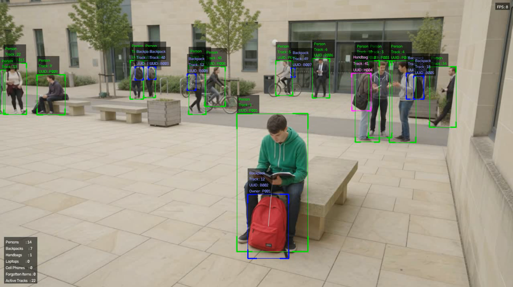
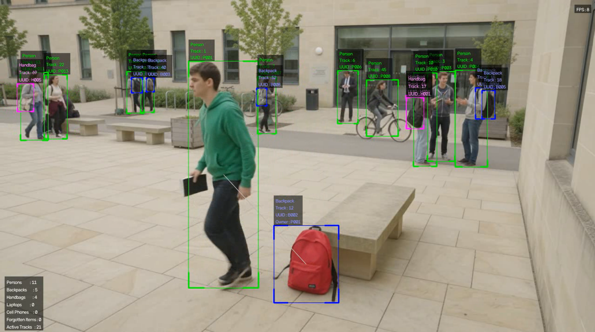
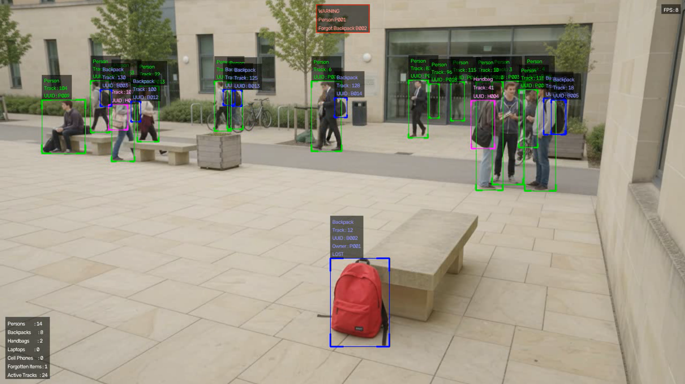
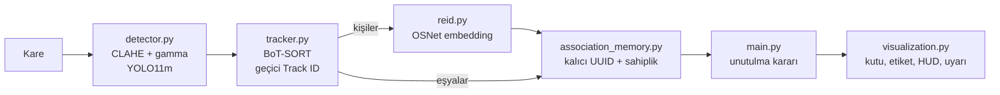

# Kayıp Eşya Takibi — Unutulan Eşya Tespit Sistemi

Video veya kamera görüntüsünde kişileri ve eşyaları (sırt çantası, el çantası, valiz, laptop, cep telefonu) tespit eden, her eşyayı **sahibiyle eşleştiren** ve sahibi eşyasından uzaklaşıp onu geride bıraktığında **uyarı üreten** bir bilgisayarlı görü sistemi.

**YOLO11** ile tespit, **BoT-SORT** ile kısa süreli takip, **OSNet** ile kişi yeniden tanıma (ReID) ve zamansal kanıta dayalı bir sahiplik belleği kullanır. Eşikler piksel yerine **yaklaşık metre** cinsindendir; bu sayede farklı kamera ve çözünürlüklerde yeniden ayar gerektirmez.

---

## Demo

**1. Sahiplik kurulur.** Bankta oturan kişiye kalıcı bir kimlik (`P001`) verilir; yanındaki kırmızı çanta `B002` olarak kaydedilir ve sahibi `P001` olarak atanır.



**2. Sahip uzaklaşır.** Kişi kalkıp yürümeye başlar, çanta bankın yanında kalır. Kişi ile eşyası arasındaki ilişki çizgisi takip edilmeye devam eder.



**3. Uyarı üretilir.** Sahip belirlenen mesafenin dışında, belirlenen süreden uzun kaldığında eşya `LOST` olarak işaretlenir ve ekranın üstünde uyarı paneli görünür. Süre uzar ve sahip daha da uzaklaşırsa durum `ABANDONED` olur.



---

## Özellikler

- **Sınıf bazlı tespit:** Kişi ve eşyalar için ayrı güven eşikleri. Yere bırakılmış, devrilmiş bir çanta kişiden çok daha düşük skor üretir; tek eşik eşya duyarlılığını öldürür.
- **Görüntü ön işleme:** CLAHE (LAB uzayında yalnızca parlaklık kanalı) ve gamma düzeltmesi.
- **Sınıflar arası çift tespit eleme:** Aynı çantanın hem `backpack` hem `handbag` olarak tespit edilip iki ayrı alarm üretmesi engellenir.
- **Kalıcı kimlik:** BoT-SORT'un geçici Track ID'si ile OSNet embedding'leri birleştirilerek kişilere değişmeyen UUID'ler (`P001`, `B003`, `H004` …) verilir.
- **Zamansal sahiplik:** Eşya, ilk karede "en yakın" kişiye değil, zaman içinde yanında en çok kanıt biriktiren kişiye atanır. Yanından geçen yayalar sahip olamaz.
- **Ölçekten bağımsız mesafe:** Kişinin kutu yüksekliği ölçek çubuğu olarak kullanılır; mesafeler yaklaşık metreye çevrilir.
- **Geri gitmeyen durum makinesi:** `NORMAL → LOST → ABANDONED`. Uyarı kare kare yanıp sönmez.
- **Yanlış alarm korumaları:** Taşınan eşya, birinin elinde/ayak dibinde duran eşya ve kısa süre engel arkasında kalan sahip alarm üretmez.
- **GPU desteği:** CUDA + FP16 çıkarım, model ısındırma, ultralytics 8.3 / 8.4 API uyumluluğu.
- **Tek noktadan yapılandırma:** Tüm parametreler `.env` dosyasından okunur ve açılışta doğrulanır.

---

## Nasıl Çalışır

Her kare aşağıdaki boru hattından geçer:



### Sahiplik ataması

Sahiplik bir kez kurulduğunda değiştirilmez; bu yüzden atama anının doğruluğu kritiktir. Her eşya için yakındaki kişilerin **kanıt puanı** tutulur:

- Eşyaya `OWNERSHIP_DISTANCE_M` (0.6 m) mesafeden yakın her kişi, her karede geçen süre ve yakınlığı oranında kanıt kazanır.
- Kanıt, `OWNERSHIP_MEMORY_TIME` (5 sn) zaman sabitiyle söner.
- Lider aday; `OWNERSHIP_CONFIRM_TIME` (1 sn) kanıta ulaştığında, ikinci adayın en az `OWNERSHIP_DOMINANCE` (2) katı kanıta sahip olduğunda ve kimliği çözülmüş olduğunda sahip olarak atanır.
- Kimliği henüz çözülemeyen kişi Track ID'si ile kanıt toplar; UUID'si belli olunca kanıtı ona aktarılır.

Sahipliği henüz kesinleşmemiş eşyada lider aday etikette `Owner : P003?` biçiminde gösterilir.

### Mesafe ölçümü

```
yaklaşık_metre = (eşya ile kişi kutusu arasındaki kenar boşluğu / kişinin kutu yüksekliği) × PERSON_HEIGHT_M
```

Kişinin kutu yüksekliği, bulunduğu derinlikte doğal bir ölçek çubuğudur (varsayılan 1.7 m). Merkez mesafesi yerine kenar mesafesi kullanılır; masada oturan birinin hemen yanındaki telefon "uzakta" sayılmaz.

### Unutulan eşya kuralı

Sahibi atanmış her eşya için, her karede sırayla:

| Sıra | Koşul | Sonuç |
|---|---|---|
| 1 | Sahip görünüyor ve `FORGET_DISTANCE_M` (2 m) içinde | `NORMAL`, sayaç sıfırlanır |
| 2 | Eşya son `ITEM_MOTION_WINDOW` sn'de kendi köşegeninden fazla yer değiştirdi (taşınıyor) | `NORMAL`, sayaç sıfırlanır |
| 3 | Eşya bu karede tespit edilemedi, **veya** sahip eşyanın yanındayken kadraj ortasında kısa süre kayboldu, **veya** eşya herhangi bir kişinin kutusunun içinde | Sayaç **durur**, durum korunur |
| 4 | Yukarıdakilerin hiçbiri | Sayaç ilerler: `FORGET_TIME` dolunca `LOST`; `ABANDONED_TIME` dolunca ve sahip `ABANDONED_DISTANCE_M` (3 m) dışındaysa `ABANDONED` |

Bir uzaklaşma dönemi içinde durum geri gitmez. Durumu yalnızca sahibin dönmesi (1) veya eşyanın taşınması (2) sıfırlar. 2 m / 3 m varsayılanları PETS 2006/2007 terk edilmiş bagaj tanımını izler.

---

## Proje Yapısı

```
Lost-Item-Detection/
├── assets/                  # Girdi videoları (repoda yok)
├── models/                  # OSNet ağırlıkları (install.py indirir, repoda yok)
├── results/                 # Çıktı videoları ve loglar (repoda yok)
├── docs/
│   └── images/              # README görselleri
├── src/
│   ├── config.py            # .env okuma, tip dönüşümü, doğrulama
│   ├── detector.py          # Ön işleme + YOLO tespiti
│   ├── tracker.py           # BoT-SORT takibi (geçici Track ID)
│   ├── osnet.py             # Projeye gömülü OSNet mimarisi
│   ├── reid.py              # Embedding çıkarımı ve galeri eşleştirme
│   ├── association_memory.py# Kalıcı UUID'ler ve sahiplik belleği
│   ├── distance.py          # Geometri: kenar mesafesi, IoU, metre tahmini
│   ├── visualization.py     # Çizim (karar vermez)
│   └── utils.py             # Cihaz seçimi, crop, logger
├── main.py                  # Orkestrasyon + unutulan eşya kararı
├── install.py               # Bağımlılık kurulumu ve GPU doğrulaması
├── requirements.txt
└── example.env              # Yapılandırma şablonu
```

| Modül | Sorumluluk |
|---|---|
| `config.py` | Tüm ayarların tek kaynağı. Hiçbir modül `.env`'i doğrudan okumaz. Tutarsız değerleri (ör. `ABANDONED_TIME < FORGET_TIME`) açılışta tek seferde raporlar. |
| `detector.py` | CLAHE + gamma, YOLO çıkarımı, sınıf bazlı güven eşiği, sınıflar arası çift tespit eleme. |
| `tracker.py` | BoT-SORT ile kısa süreli takip. Track ID kalıcı kimlik **değildir**. |
| `osnet.py` | OSNet'in bağımsız tanımı; torchreid/boxmot ağırlık dosyalarını doğrudan yükler. Ek kütüphane gerekmez. |
| `reid.py` | Kişi kırpıntısından L2-normalize embedding üretir, galeriyle karşılaştırır: `MATCHED` / `NEW` / `UNCERTAIN`. |
| `association_memory.py` | Person/Item UUID üretimi, zamansal kanıtla sahiplik, takibi kopan eşyanın yeniden eşleştirilmesi, bellek bakımı. |
| `distance.py` | Yalnızca geometri; karar vermez. |
| `visualization.py` | Kutular, etiketler, ilişki çizgisi, HUD, FPS, uyarı panelleri. Durumsuzdur, karar vermez. |
| `main.py` | Modülleri sırayla çalıştırır. Unutulan eşya iş kuralı (`AbandonmentMonitor`) yalnızca buradadır. |

---

## Kurulum

### Gereksinimler

- Python **3.10+**
- NVIDIA GPU ve güncel sürücü (önerilir; CPU'da da çalışır ama yavaştır)

### 1. Repoyu klonlayın ve sanal ortam oluşturun

```bash
git clone https://github.com/EmircanOzkaya17/Lost-Item-Detection.git
cd Lost-Item-Detection

python -m venv .venv
# Windows
.venv\Scripts\activate
# Linux / macOS
source .venv/bin/activate
```

### 2. Bağımlılıkları kurun

**Önerilen yol:**

```bash
python install.py
```

`install.py` sırasıyla:

1. Çekirdek paketleri (numpy, opencv-python, python-dotenv) kontrol eder ve eksikleri kurar.
2. `nvidia-smi` ile sürücünün CUDA sürümünü ve GPU mimarisini okuyup **doğru PyTorch derlemesini** PyTorch'un kendi deposundan kurar. Kurulu torch CPU sürümüyse ve GPU varsa onu değiştirir.
3. ultralytics, lap ve gdown'u kurar.
4. `assets/`, `results/`, `models/` klasörlerini oluşturur.
5. OSNet ağırlığını (`models/osnet_x1_0_msmt17.pt`) Google Drive'dan indirir. `yolo11m.pt` ilk çalıştırmada ultralytics tarafından otomatik indirilir.
6. Import'ları, GPU'yu ve FP16 çıkarımı gerçek bir testle doğrular.

Faydalı seçenekler:

```bash
python install.py --dry-run       # hiçbir şey kurmadan durumu raporla
python install.py --cuda cu126    # PyTorch CUDA etiketini elle seç (cu130, cu126, cu118, cpu)
python install.py --skip-weights  # OSNet ağırlığını indirme
```

**Elle kurulum:** PyTorch **mutlaka önce** ve kendi deposundan kurulmalıdır. Aksi halde ultralytics, bağımlılık olarak torch'un CPU sürümünü çeker ve ekran kartı kullanılamaz.

```bash
pip install torch torchvision --index-url https://download.pytorch.org/whl/cu130
pip install -r requirements.txt
```

Ardından OSNet ağırlığını `install.py` içindeki bağlantıdan indirip `models/osnet_x1_0_msmt17.pt` olarak kaydedin.

### 3. Yapılandırma dosyasını oluşturun

```bash
# Windows
copy example.env .env
# Linux / macOS
cp example.env .env
```

### 4. Videonuzu ekleyin

Videoları repoda tutmuyoruz. Kendi videonuzu `assets/` klasörüne koyun ve `.env` içindeki `VIDEO_PATH` değerini güncelleyin ya da `--video` parametresiyle verin.

---

## Kullanım

```bash
python main.py                                                # .env'deki ayarlarla
python main.py --video assets/deneme.mp4 --output results/cikti.mp4
python main.py --video 0 --no-save                            # web kamerası
```

| Parametre | Açıklama |
|---|---|
| `--video` | Video dosyası veya kamera indeksi (ör. `0`). Verilmezse `.env` → `VIDEO_PATH` |
| `--output` | Çıktı videosunun yolu. Verilmezse `.env` → `OUTPUT_PATH` |
| `--no-save` | Çıktı videosu kaydetme |
| `--no-show` | Önizleme penceresi açma (sunucu / headless kullanım) |
| `--env` | Alternatif bir `.env` dosyası kullan |

Önizleme penceresinden `q` veya `ESC` ile çıkılır. İşleme sırasında her 100 karede bir ilerleme, sonunda da toplam kişi, eşya, sahiplik ve terk edilmiş eşya özeti loglanır.

> Süre hesapları gerçek zaman yerine **video zamanı** (`kare_indeksi / fps`) ile yapılır. Sonuçlar işleme hızından bağımsız ve tekrarlanabilirdir.

### Ekrandaki öğeler

| Renk | Sınıf | UUID öneki |
|---|---|---|
| Yeşil | Person | `P` |
| Mavi | Backpack | `B` |
| Mor | Handbag | `H` |
| Camgöbeği | Suitcase | `S` |
| Turuncu | Laptop | `L` |
| Sarı | Cell Phone | `C` |

- **Etiket:** sınıf, Track ID, UUID, sahip (`Owner`) ve varsa durum (`LOST` / `ABANDONED`).
- **Gri çizgi:** kişi ile sahibi olduğu eşya arasındaki ilişki.
- **Kırmızı panel (üst orta):** `WARNING` (eşya unutuldu) veya `ABANDONED ITEM` (eşya terk edildi).
- **HUD (sol alt):** sınıf bazlı sayımlar, unutulan eşya sayısı, aktif takip sayısı.
- **FPS (sağ üst):** ortalama işleme hızı.

---

## Yapılandırma

Tüm parametreler `.env` dosyasındadır; her birinin açıklaması `example.env` içinde yer alır. En sık değiştirilenler:

| Parametre | `example.env` | Açıklama |
|---|---|---|
| `MODEL_PATH` | `yolo11m.pt` | YOLO ağırlığı (COCO, eğitim yapılmaz) |
| `MODEL_IMGSZ` | `1280` | Model giriş çözünürlüğü (32'nin katı) |
| `CONF_THRESHOLD` | `0.25` | Kişi güven eşiği |
| `ITEM_CONF_THRESHOLD` | `0.10` | Eşya güven eşiği |
| `TARGET_CLASSES` | `person,backpack,handbag,suitcase,cell phone,laptop` | Takip edilecek sınıflar |
| `USE_GPU` / `USE_FP16` | `true` / `true` | GPU ve yarım hassasiyet |
| `REID_THRESHOLD` | `0.65` | Bu benzerliğin üstü aynı kişi |
| `NEW_PERSON_THRESHOLD` | `0.45` | Bu benzerliğin altı yeni kişi (arası kararsız) |
| `PERSON_HEIGHT_M` | `1.7` | Metre tahmini için varsayılan kişi boyu |
| `OWNERSHIP_DISTANCE_M` | `0.6` | Sahiplik kanıtı toplama mesafesi |
| `FORGET_DISTANCE_M` | `2.0` | Bu mesafenin dışı "uzaklaştı" sayılır |
| `ABANDONED_DISTANCE_M` | `3.0` | Terk edilme için gereken mesafe |
| `FORGET_TIME` | `1.0` | `LOST` için gereken süre (sn) |
| `ABANDONED_TIME` | `2.0` | `ABANDONED` için gereken süre (sn) |
| `VIDEO_PATH` / `OUTPUT_PATH` | `assets/...` / `results/output.mp4` | Girdi ve çıktı |

> **Not:** `example.env` içindeki `FORGET_TIME=1.0` ve `ABANDONED_TIME=2.0` değerleri kısa demo videoları içindir. Gerçek bir kurulumda **10 / 30 sn** önerilir (`config.py` varsayılanları da bu değerlerdir).

Artık kullanılmayan bir anahtar (ör. eski piksel tabanlı `FORGET_DISTANCE`) `.env` dosyasında kalırsa açılışta uyarı verilir ve yok sayılır.

---

## Bilinen Sınırlar

- **Derinlik:** Kalibrasyonsuz tek kamerada, görüntüde üst üste binen ama farklı derinlikteki kişi ile eşya ayırt edilemez. Zamansal kanıt ve baskınlık şartı bunu büyük ölçüde telafi eder, tamamen çözmez.
- **Oturan kişiler:** Kutuları kısa olduğu için metre tahmini biraz yüksek çıkar; alarm biraz geç gelir.
- **İki kişinin ortasındaki eşya:** Baskınlık şartı sağlanmadığı için sahipsiz kalır; biri ayrılınca diğerine atanır. Yanlış alarmı önlemek için bilinçli bir ödünleşimdir.
- **Sahipsiz eşya alarmı yok:** Sahibi hiç belirlenemeyen eşya için alarm üretilmez.
- **Uzak kişiler:** Çok küçük kırpıntılarda ReID güvenilirliği düşer. `REID_MIN_CROP_HEIGHT` değerini 80–96 px'e çıkarmak kimlik kopmalarını azaltır.

---
